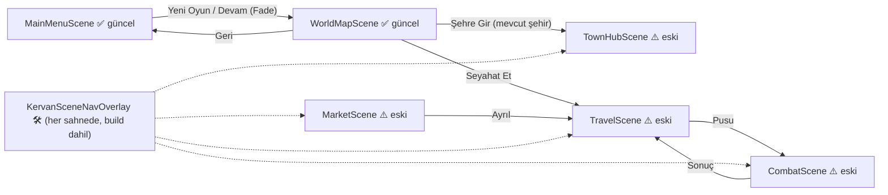
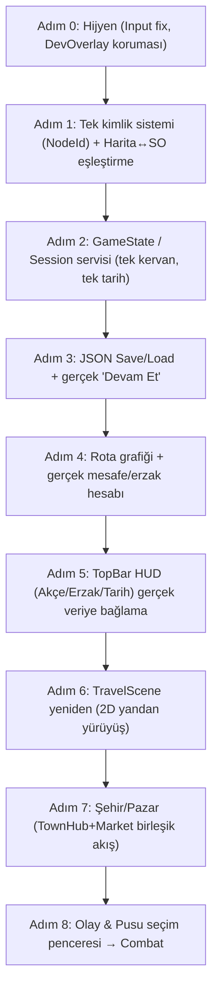

# 🧭 Uç Beyliği Kervanı — Detaylı Proje Analiz Raporu

> **Tarih:** 14.10.2026 · **Kapsam:** Salt okunur analiz (projede **hiçbir dosya değiştirilmedi**)
> **Odak:** `MainMenuScene` + `WorldMapScene` (güncel) · Diğer sahneler (`TravelScene`, `MarketScene`, `TownHubScene`, `CombatScene`) "eski/prototip" kabul edildi.
> **İncelenen:** 3 doküman, 54 C# script, 6 proje sahnesi (sadece referans taraması), 30 ScriptableObject, 10 prefab, ~120 görsel/ses varlığı, ProjectSettings, paket manifesti.

---

## 0. Yönetici Özeti (1 dakikada)

| Alan | Durum | Not |
|---|---|---|
| Görsel kimlik & UI cilası | 🟢 İyi | Ana menü ve harita "oyun gibi" görünüyor; ses, fade, safe-area, çekmece mantığı yerinde. |
| Veri modeli (ScriptableObject) | 🟡 Orta | Yapı doğru kurulmuş, ama **haritadaki düğümlerle SO verileri birbirini tutmuyor.** |
| Oyun döngüsü (gameplay loop) | 🔴 Yok | Harita → Seyahat → Varış → Şehir döngüsü henüz gerçek veriyle çalışmıyor; çoğu değer sabit kodlanmış (hardcoded) / sahte (mock). |
| Mimari | 🟡 Orta | EventBus var ama az kullanılıyor; 5+ Singleton, isim-tabanlı `GameObject.Find`, sahneye bağımlı veri. |
| Kayıt sistemi | 🔴 Yok | Sadece `PlayerPrefs` bayrakları (`HasSavedGame`, `CurrentCity`). Kervan verisi her açılışta sıfırlanıyor. |
| Mobil teknik hazırlık | 🟡 Orta | Landscape kilidi doğru; ancak **Input System ayarıyla çakışan kod** ve eksik Android ayarları var. |
| Varlık (Asset) disiplini | 🟡 Orta | `Sprites/UI/...` düzenli; ancak kökte standart dışı klasörler ve mükerrer dosyalar kalmış. |

**Ana tespit:** Proje "görsel olarak" Aşama 2'nin sonunda, ama "sistemsel olarak" Aşama 0–1 arasında. Bundan sonraki en değerli iş **yeni ekran eklemek değil, mevcut iki sahnenin altına gerçek bir veri/durum omurgası (GameState + Save) koymak.** Bu yapılmazsa her yeni sahne (Travel, Market…) tekrar sahte veriyle yazılır ve en sonda hepsini sökmek gerekir.

---

## 1. Mevcut Durum Röntgeni

### 1.1 Sahne Haritası

### 1.2 Hangi Script Hangi Sahnede? (referans taraması)

| Script | Sahneler | Yorum |
|---|---|---|
| `MainMenuUI`, `ScreenFader` | MainMenu | `ScreenFader` **sadece** MainMenu'de → haritaya girişte "kararıp birden açılma" (fade-in yok). |
| `WorldMapUI`, `InventorySidebarUI`, `StoryIntroUI`, `CaravanManager` | WorldMap | `CaravanManager` haritada yaratılıyor (MainMenu'de değil). |
| `AudioManager` (prefab) | 5 sahnede (Travel hariç) | Singleton olduğu için kopyalar yok ediliyor; çalışıyor ama "her sahneye koy" yaklaşımı kırılgan. |
| `TravelManager` | Travel | **Kendi ayrı `CaravanData` kopyasını tutuyor** (aşağıda detay). |
| `QuestManager`, `ReputationManager`, `ShopManager` | **Hiçbiri** | TownHub'daki istihbarat/itibar/dükkân sistemleri sahnede yok → çalışmaz. |
| `SafeAreaFitter` | 6 sahnenin hepsi | ✅ |

### 1.3 Kod Hacmi (dikkat çeken dosyalar)

| Dosya | Satır | Not |
|---|---|---|
| [InventorySidebarUI.cs](file:///c:/Projects/kervanOyun/Assets/_Project/Scripts/UI/InventorySidebarUI.cs) | 1084 | Tek dosyada sekme, layout, prosedürel satır üretimi, safe-area, ses… "God class" eğilimi. |
| [WorldMapUI.cs](file:///c:/Projects/kervanOyun/Assets/_Project/Scripts/TradeAndTravel/WorldMapUI.cs) | 459 | Orkestratör + veri + ses + mute + sahne geçişi bir arada. |
| [BottomNodeInfoCardUI.cs](file:///c:/Projects/kervanOyun/Assets/_Project/Scripts/UI/BottomNodeInfoCardUI.cs) | 397 | |
| [MapPanZoomController.cs](file:///c:/Projects/kervanOyun/Assets/_Project/Scripts/UI/MapPanZoomController.cs) | 316 | |

---

## 2. Tespit Edilen Sorunlar ve Riskler (Kod okumasına dayalı)

> [!IMPORTANT]
> Aşağıdakiler kodun **okunmasıyla** çıkarılmıştır, Unity'de çalıştırılarak doğrulanmamıştır. 🔴 işaretlileri Unity'de bir kez kontrol etmeniz önerilir.

### 🔴 Kritik

**K1 — Input System çakışması (olası Console hatası)**
`ProjectSettings → activeInputHandler: 1` yani **sadece yeni Input System** aktif. Ancak [MapPanZoomController.cs:177](file:///c:/Projects/kervanOyun/Assets/_Project/Scripts/UI/MapPanZoomController.cs#L175-L199) ve [L226-L232](file:///c:/Projects/kervanOyun/Assets/_Project/Scripts/UI/MapPanZoomController.cs#L224-L240) eski `Input.touchCount / Input.GetTouch` kullanıyor ve bu `Update()` içinde her kare çağrılıyor. Bu ayarda Unity genellikle her karede `InvalidOperationException` fırlatır ve **pinch-zoom telefonda çalışmaz.**
→ *Soru:* WorldMap Play modunda Console'da kırmızı "You are trying to read Input using the UnityEngine.Input class…" hatası görüyor musunuz?

**K2 — Harita düğümleri ile veri (SO) eşleşmiyor**
- Sahnede 13 düğüm var: `Node_Ahlat, Ankara, Antalya, Bursa, Cakalli, Eskisehir, Izmir, Iznik, Karatay, Kutahya, Sogut, Tashan, Trabzon`.
- ScriptableObject'lerde 6 düğüm var: `Bilecik, Bursa, Domanic, Iznik, KaratayHan, Sogut`.
- Eşleştirme, GameObject adından türetilen metinle (`"Sogut"`, `"Bursa"`, `"Iznik"`) SO'daki `NodeName` (`"Söğüt"`, `"Bursa (Prusa)"`, `"İznik (Nikaia)"`) veya `NodeId` (`"node_sogut"`) arasında yapılıyor → [WorldMapUI.cs:270](file:///c:/Projects/kervanOyun/Assets/_Project/Scripts/TradeAndTravel/WorldMapUI.cs#L258-L290). **Hiçbiri tutmuyor**, yani bilgi kartı büyük ihtimalle her düğüm için yedek/varsayılan metin gösteriyor.
- GDD Madde 11/7: *"İlk sürümde sadece Anadolu/Bitinya haritası"* — sahnede Antalya, İzmir, Trabzon, Ahlat var. Tasarım kararıyla çelişiyor (bilinçli bir değişiklikse doküman güncellenmeli).

**K3 — "Bulunduğun şehir" kontrolü Türkçe karakterden kırılıyor**
Yeni oyunda `CurrentCity = "Söğüt"` yazılıyor ([MainMenuUI.cs:160](file:///c:/Projects/kervanOyun/Assets/_Project/Scripts/UI/MainMenuUI.cs#L154-L165)), ama tıklanan düğümün adı `"Sogut"`. `"Sogut" == "Söğüt"` → **false**. Sonuç: oyuncu kendi şehrine tıklayınca "Şehre Gir" yerine **kendi şehrine 2–5 günlük rastgele seyahat** önerisi görebilir ([WorldMapUI.cs:272-L275](file:///c:/Projects/kervanOyun/Assets/_Project/Scripts/TradeAndTravel/WorldMapUI.cs#L272-L276), [L292-L305](file:///c:/Projects/kervanOyun/Assets/_Project/Scripts/TradeAndTravel/WorldMapUI.cs#L292-L305)). Marker'ın Söğüt'e oturması ise sadece "fallback: Node_Sogut" sayesinde tesadüfen çalışıyor.
→ *Kural önerisi:* Kimlik için **asla görünen isim kullanılmamalı**; sadece ASCII `NodeId` (`node_sogut`).

**K4 — Seyahat oyuncuyu yola çıkmadan ışınlıyor**
"Seyahat Et"e basıldığında `CurrentCity` **hemen** hedef şehre yazılıyor ([WorldMapUI.cs:319-L321](file:///c:/Projects/kervanOyun/Assets/_Project/Scripts/TradeAndTravel/WorldMapUI.cs#L315-L324)). Pusu/yenilgi/geri dönüş olursa oyuncu yine de hedefte görünür. Ayrıca uygulama seyahatte kapanırsa hedefe varmış sayılır.

**K5 — İki ayrı kervan verisi**
[TravelManager.cs:27](file:///c:/Projects/kervanOyun/Assets/_Project/Scripts/TradeAndTravel/TravelManager.cs#L26-L30) kendi `new CaravanData()` kopyasını tutuyor; [CaravanManager](file:///c:/Projects/kervanOyun/Assets/_Project/Scripts/TradeAndTravel/CaravanManager.cs) ise başka bir kopya. Seyahatte harcanan erzak/akçe haritadaki kervana **yansımaz.** (TravelScene yeniden yazılırken mutlaka düzeltilmeli.)

### 🟠 Yüksek

| # | Sorun | Yer |
|---|---|---|
| Y1 | **Kayıt sistemi yok.** `CaravanManager` her açılışta 500 akçe/20 erzak ile sıfırdan başlıyor. "Devam Et" sadece konumu hatırlıyor. | [CaravanData.cs](file:///c:/Projects/kervanOyun/Assets/_Project/Scripts/TradeAndTravel/CaravanData.cs#L51-L63) |
| Y2 | **Test menüsü build'e giriyor.** `KervanSceneNavOverlay` `[RuntimeInitializeOnLoadMethod]` ile **her sahnede ve release build'de** sağ üstte açılıyor; sizin Utility Drawer'ınızla aynı köşeye biniyor. `#if UNITY_EDITOR \|\| DEVELOPMENT_BUILD` koruması yok. | [KervanSceneNavOverlay.cs](file:///c:/Projects/kervanOyun/Assets/_Project/Scripts/Core/KervanSceneNavOverlay.cs#L16-L25) |
| Y3 | **Sabit kodlu oyun değerleri:** tarih `"14 Mayıs 1326"`, mesafeler (`sogut→bilecik = 1` ama `Route_Sogut_Bilecik = 2 gün`), varsayılan 500 akçe. | [WorldMapUI.cs:247](file:///c:/Projects/kervanOyun/Assets/_Project/Scripts/TradeAndTravel/WorldMapUI.cs#L238-L248), [L292-L305](file:///c:/Projects/kervanOyun/Assets/_Project/Scripts/TradeAndTravel/WorldMapUI.cs#L292-L305) |
| Y4 | **Sidebar sahte veri gösteriyor.** Kervan boşken "3 Muhafız, 2 Okçu, 10 İpek…" gibi test satırları basılıyor; görevler tamamen sabit metin. Oyuncu gerçek durumu göremez. | [InventorySidebarUI.cs:421-L470](file:///c:/Projects/kervanOyun/Assets/_Project/Scripts/UI/InventorySidebarUI.cs#L421-L470) |
| Y5 | **Rota grafiği yok.** 13 düğüm var, 4 rota var. "Hangi şehirden hangisine gidilebilir?" bilgisi yok; her düğüme her yerden gidilebiliyor. | `ScriptableObjects/Routes` |
| Y6 | **Ses/Mute mantığı iki yerde farklı yazılmış.** MainMenu sadece `AudioManager`'ı susturuyor; WorldMap ayrıca `AudioListener.pause = true` ve sahnedeki **tüm** AudioSource'ları `mute` ediyor. `AudioListener.pause` sahne değişince sıfırlanmıyor → menüye dönünce tutarsız durum. Ses ayarları da kalıcı (PlayerPrefs) kaydedilmiyor. | [WorldMapUI.cs:367-L392](file:///c:/Projects/kervanOyun/Assets/_Project/Scripts/TradeAndTravel/WorldMapUI.cs#L367-L392), [MainMenuUI.cs:230-L245](file:///c:/Projects/kervanOyun/Assets/_Project/Scripts/UI/MainMenuUI.cs#L230-L245) |
| Y7 | **Ölü yedek kodlar:** `Resources.Load(...)` 7 yerde çağrılıyor ama `_Project` altında **hiç `Resources` klasörü yok** → bu fallback'ler hiçbir zaman çalışmaz, sadece yanlış güven verir. | AudioManager, UIButtonSound, WorldMapUI, BottomNodeInfoCardUI, InventorySidebarUI |

### 🟡 Orta

- **İsim-tabanlı bağlama:** `GameObject.Find("Btn_Inventory") ?? "BtnInventory" ?? ...`, `name.StartsWith("Node_")`. Bir objenin adını değiştirmek sessizce özelliği bozar. Inspector referansı veya bileşen (ör. `MapNodeView`) tercih edilmeli.
- **Sahne geçişi tutarsız:** MainMenu fade'li; WorldMap → diğer sahneler `SceneManager.LoadScene` ile sert geçiş, fade-in yok. Async yükleme/yükleme ekranı yok.
- **Singleton yoğunluğu:** `AudioManager`, `CaravanManager`, `QuestManager`, `ReputationManager`, `ShopManager`, `ScreenFader` — AGENTS.md "Singleton karmaşasına girme" kuralıyla gerilim var.
- **EventBus potansiyeli düşük kullanılıyor:** Sadece 7 olay tipi var; `TravelManager` C# `event` + EventBus karışık. Ayrıca bus statik; Domain Reload kapalıysa (Enter Play Mode Options) eski abonelikler kalabilir — `ClearAll()` hiçbir yerde çağrılmıyor.
- **Yorum dili tutarsız:** Eski dosyalarda Türkçe karaktersiz yorum (`Kervanin seyahatini...`), yenilerde Türkçe karakterli. (AGENTS.md: Türkçe karakterli olmalı.)
- **`FactionType` enum'u GDD ile uyuşmuyor:** GDD 4 fraksiyon diyor (Osmanlı, Bizans, Eşkıya, Vahşi Hayvan); enum'da `Steppe`, `SeljukLegacy` var, `WildAnimal` yok.
- **Yeni Oyun tam sıfırlamıyor:** `HasSeenIntro_v1`, kervan verisi vb. sıfırlanmıyor; "Yeni Oyun" var olan kaydın üzerine onaysız yazıyor.

### ⚪ Düşük (Temizlik)

- **Klasör standardı dışı varlıklar:** `Art/altmenu`, `Art/Icon`, `Art/Sidebar`, `Art/Toolbar`, `Art/Settings`, boş `Art/Tiles`, boş `Scripts/Core/Editor`, `Assets/Scenes/SampleScene.unity`, `Assets/Welcome` (2D şablon kalıntısı), TextMesh Pro `Examples & Extras` (~30 örnek sahne).
- **Mükerrer dosyalar:** `exitIcon.png` ×3, `Item_Akce.png` & `Item_Erzak.png` hem `Items/` hem `Icons/`, `UI_BG_Button.png` ≈ `UI_Btn_Standard.png` (ikisi de 93 KB), `Icon_MusicOn` / `Icon_Util_VolumeOn` / `Icon/MusicOn` üçlüsü.
- **Yazım hataları (isimlendirme):** `Item_Healt`, `Mauhafiz_ProfileCard`, `UI_TollbarItemBG`, `SeperatorContainer`.
- **Önek kuralına uymayanlar:** `BottomMenuBtn.png`, `Btn_Exit.png`, `sidebarBtnOnClick.png`, `toolbarAkceIcon.png` (→ `UI_Btn_`, `Icon_` önekleri).
- **Büyük ham dosyalar `Assets/` içinde:** `SourceFiles/*.ai` (~14 MB) ve `UI/Mockups` PNG'leri (~10 MB). Unity bunları import eder/izler; repo büyür (şu an pack 70 MB, **Git LFS yok**).
- **ProjectSettings:** `applicationIdentifier` boş, `AndroidTargetSdkVersion: 0` (otomatik—OK), `AndroidTargetArchitectures: 2` (sadece ARM64 — Play Store için yeterli), `bundleVersion 1.0` ama UI'da `v0.1.0` yazıyor (tek kaynak olmalı → `Application.version`).
- `WorldMapScene.unity` 1.6 MB — diğer sahnelerin ~12 katı. Muhtemelen prefab'lanmamış çok sayıda UI objesi; merge çakışmalarına ve yavaş açılmaya açık.

---

## 3. ❓ Soru 1 — "Ne Yapabilirim?" (Adım adım, öncelik sırasıyla)

Önerim: **"Önce omurga, sonra yeni ekran."** Her adım küçük, tek oturumluk ve kendi başına test edilebilir.

| Adım | Ne? | Neden şimdi? | Tahmini boyut |
|---|---|---|---|
| **0. Hijyen** | `MapPanZoomController`'ı yeni Input System'e (EnhancedTouch) taşımak; `KervanSceneNavOverlay`'i `#if UNITY_EDITOR \|\| DEVELOPMENT_BUILD` ile korumak. | Telefonda zoom'un çalışması ve release'te test menüsü çıkmaması. | Küçük |
| **1. Kimlik birliği** | Her harita düğümüne bir `MapNodeView` bileşeni (Inspector'dan `LocationNodeSO` atanır). Eksik SO'ları oluşturmak (Ankara, Eskişehir, Kütahya…) **veya** haritayı GDD kapsamına (Bitinya) daraltmak. | K2 + K3 hatalarını kökten çözer; isimle arama biter. | Orta |
| **2. GameState** | Sahneler arası yaşayan tek bir `GameSession` (kervan, konum `NodeId`, gün sayısı, aktif seyahat, itibar). `TravelManager`'ın kendi kopyası kaldırılır. | K4, K5, Y3'ün temeli. Sonraki tüm sahneler buna bağlanacak. | Orta |
| **3. Save/Load** | `SaveData` (JSON, `Application.persistentDataPath`), sürüm alanı (`saveVersion`), otomatik kayıt (şehre giriş). "Yeni Oyun" var olan kaydı ezmeden önce onay sorar. | GDD Madde 10; mobilde uygulama her an öldürülebilir (`OnApplicationPause`). | Orta |
| **4. Rota grafiği** | `TravelRouteSO`'lar haritadaki komşulukları tanımlar; harita üzerinde rota çizgileri (UI LineRenderer / Image). Erişilemeyen düğüm "Yol yok" der. | Hardcoded mesafeler + rastgele gün sorununu bitirir. | Orta |
| **5. TopBar HUD** | Mevcut yeni varlıklar (`UI_ToolbarBG`, `toolbarAkceIcon`, `toolbarErzakIcon`) ile; değerler `GameSession`'dan, değişimde EventBus ile. Akçe değişince sayı "sayarak" animasyon. | Görsel olarak hazır, veri olarak hazır olacak → hızlı kazanım. | Küçük |
| **6. TravelScene** | GDD 6. bölümdeki yerleşim: üstte kaynaklar, ortada kervan parallax yürüyüşü, altta ilerleme çubuğu + "Mola Ver". Gün gün ilerleme (GDD Madde 11/6). | Aşama 2'nin kapanışı. | Büyük |
| **7. Şehir** | TownHub ve Market'i tek "Şehir" akışında birleştirmek (sekme: Pazar / Kervansaray / Divan). | Ticaret döngüsü oyunun kalbi. | Büyük |
| **8. Olay & Pusu** | GDD Madde 11/5: her olayda "Kaç / Haraç Ver / Savaş" penceresi; Savaş → Manuel / Otomatik. | Core loop'un kapanışı. | Büyük |

---

## 4. ❓ Soru 2 — "Ne Ekleyebilirim?" (Özellik önerileri)

### 4.1 Mevcut iki sahneye (düşük maliyet, yüksek etki)

**Ana Menü**
- 🎬 **Canlı arka plan:** `UI_BG_MainMenu` üzerinde hafif parallax (2–3 katman), uçuşan toz/yaprak partikülü, yavaş "Ken Burns" zoom. Menü statik resimden "yaşayan sahneye" döner.
- 💾 **Kayıt yuvası kartı:** "Devam Et" butonunun altında küçük parşömen: *"Söğüt · 14 Mayıs 1326 · 640 Akçe · 3 sa oynandı"*.
- ⚠️ **"Yeni Oyun" onayı:** Kayıt varsa "Mevcut seferin silinecek" uyarısı (QuitConfirm popup'ı yeniden kullanılabilir).
- 🌐 **Dil seçeneği** (TR/EN) — Ayarlar'a; Unity Localization ile (bkz. §5).
- 📜 **Künye/Krediler** ve **Gizlilik Politikası** linki (Play Store zorunluluğu).

**Dünya Haritası**
- 🛤️ **Rota çizgileri ve önizleme:** Bir düğüme tıklayınca mevcut konumdan oraya giden yol kesikli altın çizgiyle parlasın; üzerinde gün sayısı ve tehlike rozeti.
- 🌫️ **Savaş sisi (Fog of War) / keşif:** Ziyaret edilmemiş şehirler soluk/parşömen lekeli; ziyaret ettikçe "mürekkeple çizilir". Tarihsel harita hissine çok uygun.
- 🏴 **Fraksiyon sancakları:** Her düğümde küçük sancak (renkler `02-Teknik-ve-Gorsel.md` paletinden: Osmanlı `#8B261E`, Bizans `#581845`…). İtibar seviyesine göre çerçeve rengi.
- 📈 **Pazar fiyat ipuçları:** Bilgi kartında "Bursa'da İpek ucuz ↓, Konya'da pahalı ↑" — oyuncu arbitraj kararını haritada verir (GDD Madde 4'ün kalbi).
- 🕐 **Gün/Mevsim göstergesi:** TopBar'da tarih + mevsim ikonu; kışın dağ geçidi rotaları kırmızı.
- 🐪 **Hareket eden kervan ikonu:** Seyahat başlarken haritada küçük kervan, rotada kayarak ilerlesin (TravelScene'e geçmeden 1–2 sn "sinematik").
- 📍 **Mini-pusula / "Konumuma dön" butonu:** Kullanıcı haritada kaybolursa tek dokunuşla Söğüt'e odak.
- 🔔 **Bildirim rozetleri:** Sidebar butonunda "Yeni görev" kırmızı noktası.

### 4.2 Oyun sistemleri (orta-uzun vade)

- **Moral & Yorgunluk** (GDD'de var, kodda yok): Erzak bitince moral düşüşü, kervansarayda iyileşme.
- **Olay Kartları (Event Deck):** ScriptableObject tabanlı yol olayları (şu an `TravelManager` içinde `switch` ile 3 sabit olay). `RoadEventSO`: başlık, metin, görsel, seçenekler, sonuçlar, koşullar (rota tipi, mevsim, itibar).
- **Hava durumu** rotalarda (`WeatherCondition` enum'u var, kullanılmıyor).
- **Pazar doygunluğu** (GDD: aynı malı çok satınca fiyat düşer) → `CityMarket`'te altyapı kısmen var.
- **İstihbarat görev günlüğü:** Sidebar'daki "Görevler" sekmesini gerçek `QuestManager`'a bağlamak.
- **Başarımlar (Achievements):** "İlk Kâr", "Pusudan Sağ Çıkan", "Bizans'ta Casus" — Google Play Games ile.
- **Günlük/Kodeks (Codex):** Ziyaret edilen şehirlerin kısa tarihî bilgisi — tarihsel oyunlarda oyuncunun en sevdiği "bonus" içerik; ucuz, etkisi büyük.

---

## 5. ❓ Soru 3 — "Neler Kullanabilirim?" (Araç & Paket Önerileri)

### 5.1 Projede zaten yüklü ama kullanılmayan değerli paketler

| Paket | Ne işe yarar? |
|---|---|
| `com.unity.inputsystem` 1.20 | **EnhancedTouch** API ile pinch/drag (K1 çözümü). |
| `com.unity.2d.animation` + `psdimporter` + `aseprite` | Kervan/karakterleri PSD katmanlarından **bone animasyonla** canlandırma (TravelScene yürüyüşü için ideal, kare kare çizime gerek kalmaz). |
| `com.unity.timeline` | Hikâye girişi (`StoryIntroUI`), seyahat başlangıç sinematiği, savaş açılışı. |
| `com.unity.2d.spriteshape` | Haritadaki **rota çizgilerini** organik/el çizimi yol olarak çizmek. |
| `com.unity.test-framework` | Save/Load, pazar matematiği, hasar hesaplayıcı için birim testleri. |
| `com.unity.device-simulator.devices` | Çentik/safe-area testleri (roadmap'teki açık madde). |
| `com.unity.modules.adaptiveperformance` | Mobilde ısınma/FPS yönetimi (ileride). |

### 5.2 Eklenmesi önerilen Unity paketleri

| Paket | Neden? | Öncelik |
|---|---|---|
| **Localization** (`com.unity.localization`) | TR/EN metinler; şu an tüm metinler kodda gömülü. Erken başlamak, sonradan sökmekten 10× ucuz. | Yüksek |
| **Addressables** | Büyük harita/arka plan görsellerini (4–5 MB PNG'ler) ihtiyaç anında yükleme; mobil bellek. `Resources` yerine. | Orta |
| **2D Sprite Atlas (v2)** | Doküman §6 zaten öneriyor; UI draw call'larını ciddi düşürür. | Orta |
| **Unity Profiler + Memory Profiler** | Telefonda bellek/FPS ölçümü. | Orta |
| **Mobile Notifications** | "Dükkânın kâr biriktirdi" (pasif gelir) bildirimleri. | Düşük |
| **Unity Gaming Services: Analytics / Cloud Save / Remote Config** | Oyuncu nerede bırakıyor? Kayıt bulutu; ekonomi değerlerini güncellemeden ayarlamak. | Düşük (Alpha sonrası) |
| **Google Play Games Plugin** / **Firebase Auth** | Menüdeki login butonlarının gerçek karşılığı (GDD 11/2). | Düşük |

### 5.3 Ücretsiz/popüler 3. parti araçlar (Asset Store / GitHub)

| Araç | Kullanım | Not |
|---|---|---|
| **DOTween** (ücretsiz) | UI animasyonları: kart kayması, sayı sayma, nabız, sallanma. Şu an elle yazılmış coroutine/Lerp'lerin yerini alır, kodu çok kısaltır. | Endüstri standardı |
| **Feel / Nice Vibrations** (ücretli) veya kendi `Handheld.Vibrate` sarmalayıcınız | Dokunsal geri bildirim (haptic) — mobil "premium hissi". | Opsiyonel |
| **Yarn Spinner** veya **Ink** | Olay/diyalog/hikâye metinlerini koddan ayırmak; dallanan seçimler (Kaç/Haraç/Savaş). | Olay sistemi için çok uygun |
| **Newtonsoft JSON** (`com.unity.nuget.newtonsoft-json`) | Save sisteminde `Dictionary` ve sürüm geçişi desteği (`JsonUtility` sözlük desteklemez). | Save için |
| **NaughtyAttributes** / **Odin** | Inspector'ı düzenli/validasyonlu yapmak (`[Required]`, `[ShowIf]`). | Kalite |
| **UniTask** | Coroutine yerine async/await; sahne geçişleri ve fade'ler daha temiz. | Opsiyonel |
| **ParrelSync** | Aynı projeyi iki editörde açıp test (ileride çok oyunculu yoksa gereksiz). | Düşük |

### 5.4 Varlık üretimi için (doküman listesine ek)

- **Krita/Photopea** 9-slice hazırlığı · **TexturePacker** atlas · **Audacity** ses kırpma/normalize (−1 dB peak, mono SFX) · **Freesound.org / Pixabay Audio** (CC0 SFX) · **Upscayl** (AI görsel büyütme) · **rembg** (arkaplan silme).

---

## 6. ❓ Soru 4 — "Daha Profesyonel Olması İçin Neler Olabilir?"

### 6.1 Mimari (kod omurgası)

1. **Bootstrap (Başlangıç) sahnesi:** `00_Boot` sahnesi; kalıcı servisleri (Audio, Save, GameSession, SceneLoader, Fader) **bir kez** kurar, sonra MainMenu'yü yükler. Böylece "AudioManager prefab'ını her sahneye koy" ihtiyacı biter. (Editörde herhangi bir sahneden Play'e basınca da çalışsın diye küçük bir `[RuntimeInitializeOnLoadMethod]` bootstrap yeterli.)
2. **Servis bulucu (Service Locator) veya hafif DI:** Singleton yerine `Services.Get<IAudioService>()`. AGENTS.md'deki "Singleton karmaşasından kaçın" kuralıyla birebir uyumlu ve test edilebilir.
3. **Veri / Mantık / Görünüm ayrımı:**
   - *Data:* `ScriptableObject` (statik tanım) + `SaveData` (dinamik durum)
   - *Logic:* saf C# sınıfları (`TravelSystem`, `MarketSystem`) — MonoBehaviour'suz, test edilebilir
   - *View:* `...UI` bileşenleri sadece gösterir, olay yayınlar.
   Şu an `WorldMapUI` hem mesafe hesaplıyor, hem PlayerPrefs yazıyor, hem müzik çalıyor.
4. **SceneLoader servisi:** Tek noktadan async yükleme + fade + yükleme ekranı + sahne isimleri için `enum`/sabitler (string sahne adları 13 yerde dağınık).
5. **EventBus'ı genişletmek:** `TravelStartedEvent`, `DayPassedEvent`, `LocationChangedEvent`, `GameSavedEvent`… UI'lar bunları dinler; sistemler birbirini tanımaz.
6. **`InventorySidebarUI`'ı bölmek:** `SidebarTabController`, `CaravanTabView`, `CargoTabView`, `QuestTabView`, `SidebarRowView` (prefab). Prosedürel `new GameObject` UI üretimi yerine prefab → tasarımcı dostu.
7. **Assembly Definition ayrımı:** Şu an tek `Kervan.Runtime`. Öneri: `Kervan.Core`, `Kervan.Gameplay`, `Kervan.UI`, `Kervan.Editor`, `Kervan.Tests`. Derleme hızlanır, bağımlılık yönü zorunlu hale gelir (UI → Gameplay → Core).

### 6.2 Veri & İçerik

- **ID disiplini:** Tüm SO'larda ASCII `Id` zorunlu ve benzersiz; bir **Editor doğrulayıcı** (menü: *Kervan → Validate Data*) eksik/çakışan ID, boş ikon, rotası olmayan düğüm vb. raporlasın. (Bu bir editör aracıdır, sahne üretmez — AGENTS.md ile uyumlu.)
- **Denge tablosu:** Ekonomi değerleri (fiyat, erzak, maaş) için tek bir `GameBalanceSO` veya Google Sheets → CSV import. Tasarımcı kod açmadan dengeler.
- **Kayıt sürümleme:** `SaveData.version` + migrasyon fonksiyonları; güncelleme sonrası oyuncu kaydı bozulmaz.

### 6.3 UI/UX Kalitesi

- **Tasarım token'ları:** Renkler (`#F5E6D3`, `#D9B359`…) şu an kodda gömülü (`new Color(0.96f, 0.90f, 0.83f)`). Bir `UIThemeSO` (renk, font, boşluk) → tek yerden tema değişir.
- **TMP Font yönetimi:** Türkçe karakter (ğ, ş, İ, ı) içeren statik font atlası + fallback zinciri; 3 font (MedievalSharp, Metamorphous, ModernAntiqua) için hangisi başlık/hangisi gövde kararını dokümana yazmak.
- **Buton durumları:** Doküman §3 Normal/Pressed/Disabled ister — mevcut butonlarda Disabled görseli tutarlı mı kontrol edilmeli (özellikle pasif "Devam Et").
- **Dokunma hedefleri:** Min 48dp (≈72px @1080p) — harita düğüm butonları ve ikonlar ölçülmeli.
- **Erişilebilirlik:** Metin boyutu seçeneği, renk körlüğüne uygun tehlike göstergesi (sadece kırmızı değil + ikon).
- **Geri tuşu (Android Back):** Popup açıksa kapat → çekmece açıksa kapat → haritadaysa "Menüye dön?" sor. Şu an ele alınmıyor; Play Store incelemelerinde sık şikâyet konusu.

### 6.4 Performans (Mobil)

- Sprite Atlas + ASTC sıkıştırma (doküman §6) uygulanmalı; `UI_WorldMapBackground.png` (5 MB), `UI_BG_MainMenu.png` (3.8 MB), `UI_BG_Paper.png` (2.6 MB) import ayarlarında **Max Size** ve sıkıştırma kontrol edilmeli.
- Canvas bölme: Statik (arka plan) ve dinamik (HUD, sayılar) farklı Canvas'larda → her değişimde tüm harita yeniden çizilmez.
- `FindObjectsByType<AudioSource>()` gibi tüm-sahne aramalarını kaldırmak.
- `Application.targetFrameRate = 60` ve pil için menüde 30 seçeneği.

### 6.5 Süreç, Test ve Sürüm

| Konu | Öneri |
|---|---|
| **Git LFS** | `.png, .psd, .ai, .mp3, .wav, .ttf` için LFS. Repo şimdiden 70 MB; büyüdükçe klonlama/çekme yavaşlar. |
| **Ham dosyalar** | `.ai` ve mockup'ları `Assets/` dışına (ör. `ArtSource/` kök klasörü) taşımak — Unity import etmez, repo düzenli kalır. |
| **Commit disiplini** | Zaten Conventional Commits kullanıyorsunuz 👍. Her adımı ayrı branch → merge alışkanlığı. |
| **Otomatik test** | EditMode testleri: `CaravanData` (ağırlık, akçe), `DamageCalculator`, `SaveData` round-trip. |
| **Sürüm numarası** | Tek kaynak: `PlayerSettings.bundleVersion` → UI'da `Application.version`. |
| **Build profilleri** | Unity 6 Build Profiles: *Dev* (overlay + log açık) ve *Release* (overlay kapalı, `Debug.Log` strip). |
| **Log temizliği** | Çok sayıda `Debug.Log` var; release'de `[Conditional("UNITY_EDITOR")]` sarmalayıcı `KLog` ile kapatılmalı. |
| **Android hazırlığı** | `applicationIdentifier` (ör. `com.kervangames.ucbeyligi`), keystore, IL2CPP + ARM64 (✅), App Bundle (AAB), hedef API güncel. |
| **Crash raporlama** | Unity Cloud Diagnostics veya Firebase Crashlytics (Alpha testten önce). |
| **Dahili test** | Google Play Internal Testing kanalı ile 5–10 kişilik kapalı test. |

### 6.6 Dokümantasyon

- `03-Proje-Durumu.md` "TAMAMLANDI" diyor; ama kod okumasında K2/K3/K4 gibi açıklar var → durum dokümanına **"Bilinen Sorunlar (Known Issues)"** bölümü eklenmesi dürüst bir takip sağlar.
- AGENTS.md `Docs/01_OYUN_TASARIMI.md` diye referans veriyor, gerçek dosya adı `01-Oyun-Tasarimi.md` — küçük ama ileride AI oturumlarında dosya bulunamamasına yol açabilir.
- GDD'deki **Madde 7 (kod mimarisi)** gerçek koddan geride (ör. `GameManager`, `TimeManager` yok; `HexGridController` yerine `HexGrid`). Güncellenmeli.

---

## 7. Önerilen İlk 3 Oturum (Somut)

| Oturum | Hedef | Dokunulacak dosyalar (öneri, onayınızla) | Unity'de sizin yapacağınız |
|---|---|---|---|
| **1** | Hijyen: Input fix + DevOverlay koruması + mute/ses ayarı kalıcılığı | `MapPanZoomController.cs`, `KervanSceneNavOverlay.cs`, `AudioManager.cs` | Play'de Console kontrolü, Device Simulator'da pinch testi |
| **2** | Kimlik birliği: `MapNodeView` + eksik `LocationNodeSO`'lar + kapsam kararı | Yeni `MapNodeView.cs`, `WorldMapUI.cs` (sadeleştirme) | Her düğüme bileşen ekleyip SO sürüklemek |
| **3** | `GameSession` + JSON Save/Load + "Devam Et" gerçek | Yeni `GameSession.cs`, `SaveService.cs`, `SaveData.cs`; `MainMenuUI`, `WorldMapUI`, `CaravanManager` | Boot objesi eklemek, test: oyna→kapat→devam et |

---

## 8. Karar Vermeniz Gereken Konular

1. **Harita kapsamı:** Sahnede 13 şehir (Antalya, İzmir, Trabzon, Ahlat dahil) var; GDD "ilk sürüm sadece Bitinya" diyor. Hangisi geçerli? (Veri SO'ları buna göre üretilecek.)
2. **Fraksiyon listesi:** GDD'deki 4 fraksiyon mu, koddaki 5'li enum mu (`Steppe`, `SeljukLegacy`)?
3. **Eski sahneler:** `TravelScene`, `MarketScene`, `TownHubScene`, `CombatScene` — sıfırdan yeniden mi tasarlanacak, yoksa script'ler korunup sadece arayüz mü yenilenecek? (Savaş matematiği — `DamageCalculator`, `HexPathfinder` — korunmaya değer görünüyor.)
4. **3. parti paket politikası:** DOTween, Newtonsoft, Localization gibi paketleri eklemeye açık mısınız?
5. **İlk adım:** §7'deki "Oturum 1 (Hijyen)" ile mi başlayalım, yoksa roadmap'teki Seçenek 1/2/3'ten biriyle mi?

> [!NOTE]
> Bu rapor sırasında projede **hiçbir dosya oluşturulmadı, değiştirilmedi, taşınmadı veya silinmedi.** Rapor yalnızca bu konuşmanın artifact klasöründe bulunmaktadır.
